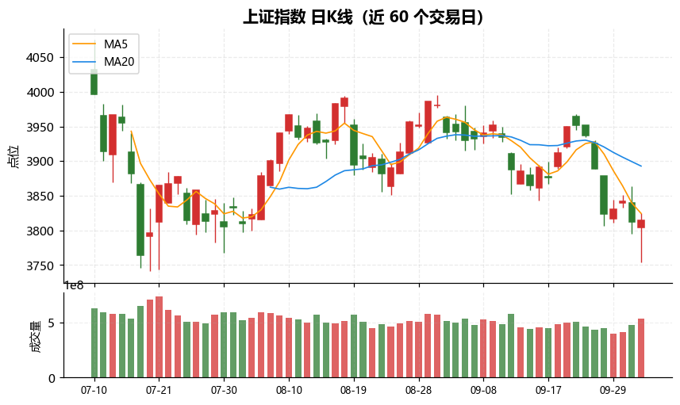
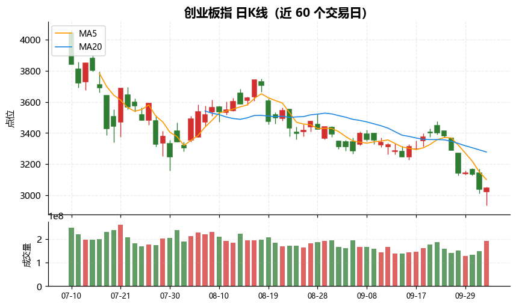
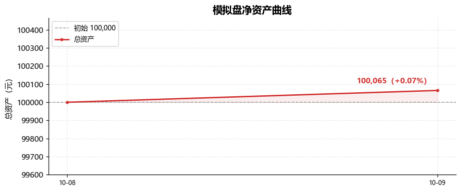

# A股AI投资复盘助手

> 给普通投资者的 AI 投研员

收盘后，它会像一支小团队一样自动把当天 A 股发生的事查清楚、算明白、写成一份专业复盘报告发到你邮箱，
还会用一笔 **10 万元模拟盘** 按纪律做一次“收盘交易”，并**回顾它过去说过的话、对账验证**。

> 本工具输出仅供研究参考，**不构成任何投资建议**。

---

## 这是什么

对普通投资者来说，每天收盘后要做的事很多：看大盘、看板块、看消息、看情绪、还要回头验证自己昨天的判断对不对——
费时、容易漏、还容易被情绪带偏。

**A股AI投资复盘助手**把这些活儿交给一组分工明确的 AI 智能体：有人负责**收集情报**，有人负责**核验事实**，
有人负责**回顾并验证往期预测**，有人负责**做技术/情绪分析**，有人负责**写报告并配图**，还有一位**模拟交易员**用
10 万虚拟资金按纪律练习买卖。

- 定位：**给普通投资者的 AI 投研员**——把专业但繁琐的复盘工作自动化，输出**看得懂、可追溯**的结论。
- 风格：**只讲证据、不编数据**。取不到的数据一律标注“缺失”，绝不臆造。

---

## 它能做什么

- **每天一份复盘报告**：大盘量价、板块资金、技术支撑压力、情绪周期、消息面与外围，一次讲清。
- **给结论、也给证伪条件**：不只说“怎么看”，还说“什么情况证明我看错了”。
- **回头验证自己**：自动翻出往期报告里对未来的预测，和今天真实走势逐条对账，算出**命中率**。
- **配图更好懂**：自动生成近三个月的指数 K 线图（蜡烛图 + 均线 + 成交量），直接放进报告与邮件。
- **顺手练交易**：10 万元模拟盘，每日按收盘价买卖个股/ETF，记录每一笔的**时间、价格、金额、仓位、盈亏、理由**。
- **邮件直达**：报告渲染成手机也能看的 HTML 邮件（表格、图片内嵌），发送到你指定邮箱。

---

## 每天它是怎么工作的

```
研究员  →  核查员  →  复盘校验员  →  分析师  →  模拟交易员  →  撰稿人
收集情报    核对事实    验证往期预测    量价/技术/情绪   10万模拟盘收盘买卖   撰写+配图+发邮件
```

一句话：**先“查清楚”，再“对账”，然后“分析”，顺手“练习交易”，最后“写成报告发出去”**。

---

## 输出示例

> 以下均为运行时真实产出（节选）。

### 1. A股复盘报告（邮件 + 归档 Markdown）

**一句话结论（节选）**
> 节后首日是典型的「权重扛指数、成长踩踏」结构性杀跌，而非系统性崩盘；两市温和放量 **1.68 万亿**、无恐慌盘，
> 但上证与创业板均处**标准空头排列**，成长指数一日穿透前低——判定为「弱势分化、反弹条件不成立」。

**主要指数（节选）**

| 指数 | 收盘 | 涨跌幅 | 量价定性 |
|---|---|---|---|
| 上证指数 | 3811.90 | **-0.79%** | 温和放量下跌 |
| 创业板指 | 3036.66 | **-3.15%** | 放量加速下杀 |
| 科创50 | 1456.32 | **-4.82%** | 领跌全场 |
| 上证50 | 2805.12 | **-0.64%** | 全场最抗跌 |

**大盘走势 K 线图（自动生成，近三个月）**





**往期预测验证（节选）** —— 报告第二节会逐条对账，并给出滚动命中率

| 报告日期 | 预测内容 | 实际走势 | 结论 |
|---|---|---|---|
| 2026-10-03 | 上证第一压力 3864（MA5） | 今日最高 3864.12，收盘未站上 | **命中**（差 0.12 点） |
| 2026-10-03 | 减仓信号：创业板破 3125 | 创业板收 3036.66，明确破位 | **命中**（信号生效） |
| 2026-09-19 | 未来 1–2 周中枢：震荡偏强 | 09-22 至 10-08 下跌 3.55% | 偏离（已归因） |

> 累计命中率示例：可验证 57 条 —— 命中 54.4%、含部分命中 82.5%（随报告累积自动更新）。

### 2. 模拟盘交易记录（10 万元，不发邮件，只出表格）

| 时间 | 代码 | 名称 | 方向 | 价格 | 数量 | 金额 | 仓位% | 状态 | 盈亏 | 理由 |
|---|---|---|---|---|---|---|---|---|---|---|
| 2026-10-09 15:00 | sz159930 | 能源ETF | 卖出 | 1.740 | 8600 | 14,964.00 | 0.0% | 已清仓 | +8.60 | 能源催化落空，换仓 |
| 2026-10-09 15:00 | sh518880 | 黄金ETF | 买入 | 8.617 | 1600 | 13,787.20 | 13.8% | 持有 | — | 黄金避险副线 |
| 2026-10-09 15:00 | sh512980 | 传媒ETF | 买入 | 0.811 | 23400 | 18,977.40 | 19.0% | 持有 | — | 当日第一主线 |

**账户**：总资产约 100,065 元（累计 +0.07%）｜仓位约 57%｜持仓 4 只 ETF。

**净资产曲线（自动生成）**



---

## 快速开始

```bash
pip install -r requirements.txt
cp .env.example .env        # 填入 DeepSeek API Key 与邮箱 SMTP 配置
python main.py              # 复盘今天；--date / --to / --quiet 可选
```

常用参数：

```bash
python main.py --date 2026-09-11     # 指定日期
python main.py --to you@qq.com       # 指定收件邮箱
python main.py --quiet               # 关闭过程日志
```

---

## 更多

- **技术细节（架构、工具、数据源、配置、排障）**：见 [`docs/技术文档.md`](docs/技术文档.md)
- **一次线上问题复盘**：见 [`BUGFIX-LLM空响应重试.md`](BUGFIX-LLM空响应重试.md)

---

## 免责声明

本项目及其生成的报告仅供技术学习与研究参考，**不构成任何投资建议**。市场有风险，投资须谨慎；据此操作，风险自负。
